# Dante OS 5.0.0 Full

**[Français](#français) · [English](#english)**

  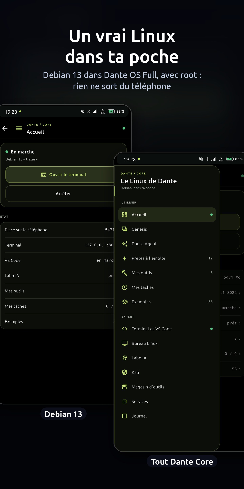 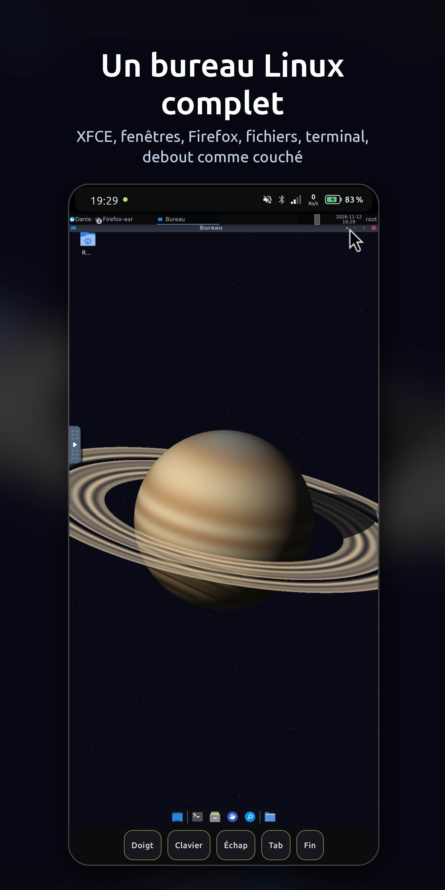  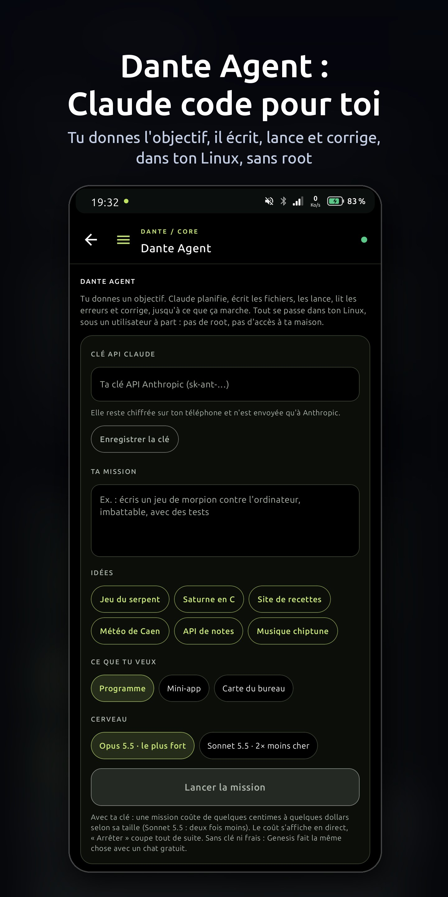

  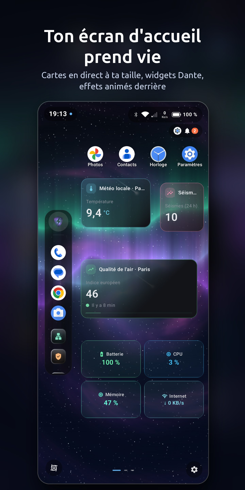 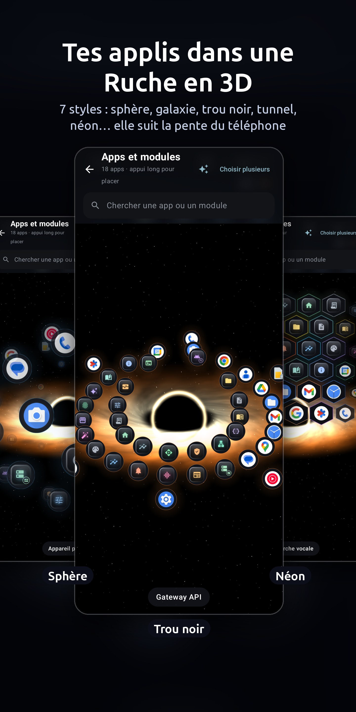 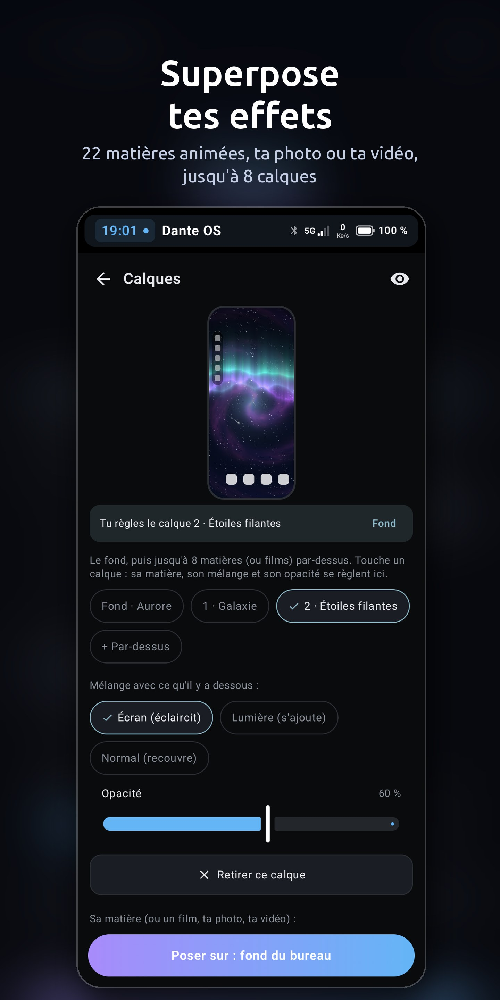 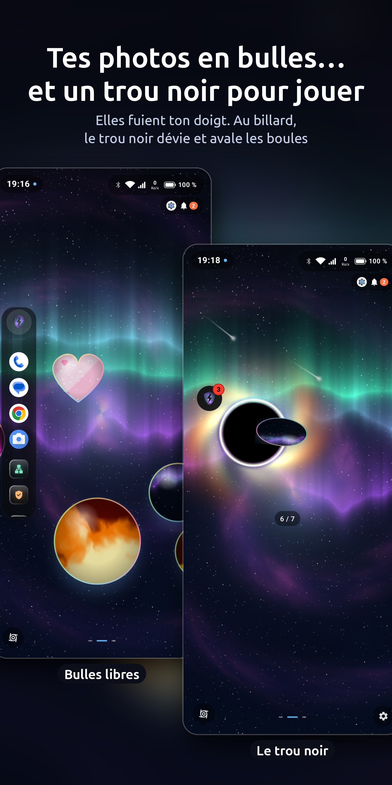

## Français

Dante OS est un launcher Android sombre et vivant, avec une trentaine de modules (données en direct, actus, fichiers, SSH, Dante IA sur le téléphone, Dante FX, Dante Engine…).

**Dante OS Full**, c'est la même appli avec en plus **Dante Core** : un vrai Linux (Debian) dans ton téléphone, ses outils, Kali, VS Code, les tâches programmées et la Fabrique. Cette version ne passe pas par le Play Store : elle se télécharge ici.

| | Play Store | **Full (ici)** |
|---|---|---|
| Launcher, modules, Dante FX, Dante IA | ✅ | ✅ |
| Dante Core (Linux, outils, Kali, VS Code) | — | ✅ (root obligatoire) |
| Dante Pro | achat Google Play | PayPal + clé |

### Dante Core en images

    

  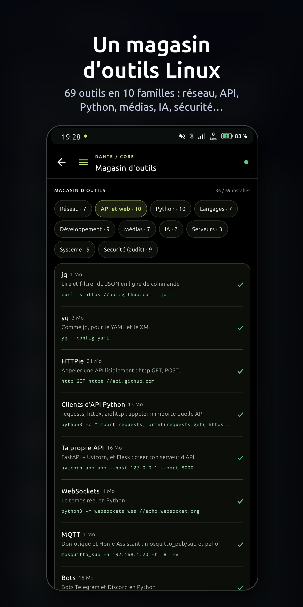 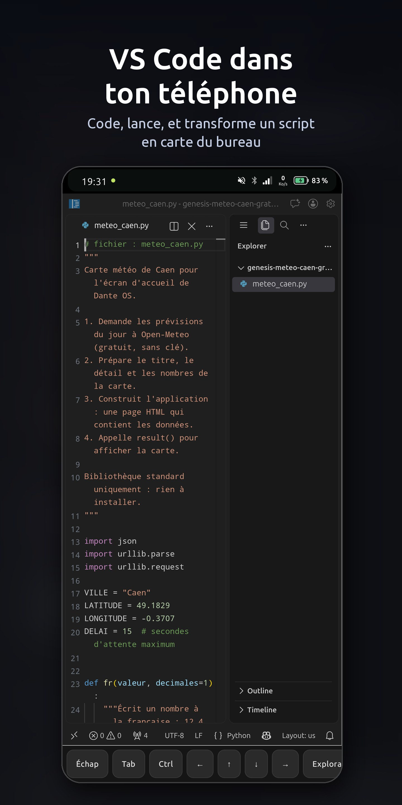 

  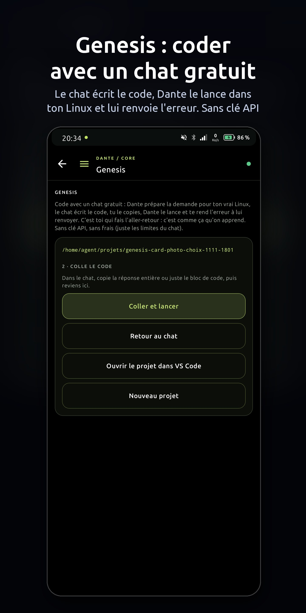 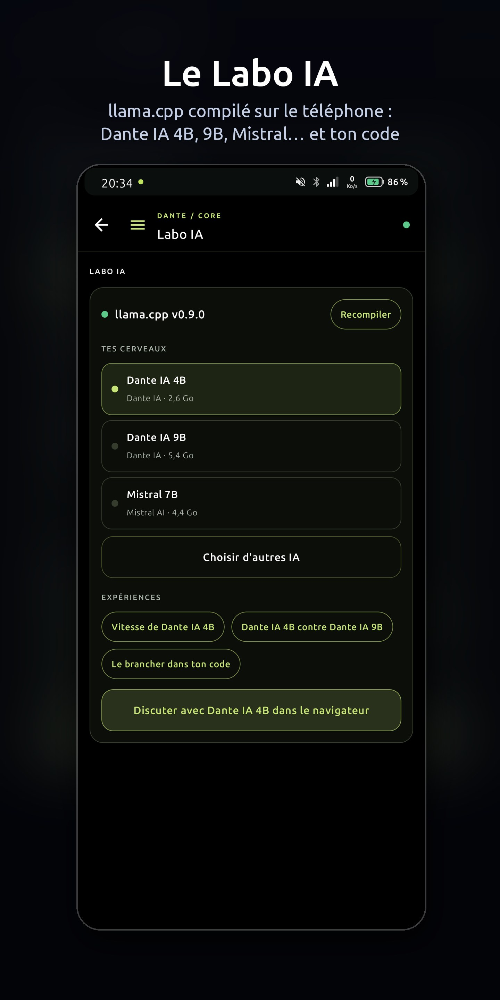 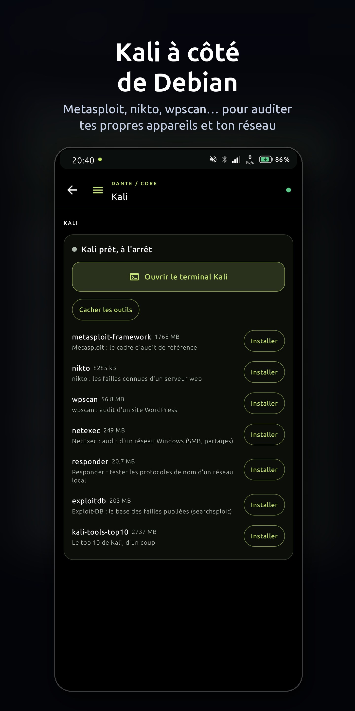

### Gratuit, et Dante Pro

Le launcher est gratuit, pour toujours : bureau, dock et ses effets, widgets, dossiers, icônes. Tous les modules s'ouvrent et se voient.
**Dante Pro** (5,99 €, une seule fois) débloque les usages avancés : Dante Core, Dante IA, Dante Engine, Dante FX, sources illimitées, serveurs SMB/FTP/SFTP…

Dans Dante OS Full : **Dante Pro ▸ Payer avec PayPal** (écris ton adresse email dans le message), tu reçois ta clé par email, tu la colles dans Dante. Il faut Internet une fois pour l'activer ; ensuite elle marche pour toujours, même sans connexion, sur 3 téléphones avec Dante OS Full.

### Installer

1. Télécharge **Dante-OS-5.0.0-Full.apk** dans [Releases](../../releases).
2. Tu as la version du Play Store ? Désinstalle-la d'abord (les deux ne peuvent pas cohabiter). Garde tes réglages avant : Bureau ▸ Personnaliser ▸ Sauvegarde ▸ Exporter.
3. Ouvre l'APK et autorise l'installation depuis cette source.
4. Pour Dante Core et les modules root : un téléphone rooté (Magisk ou KernelSU). Sans root, tout le reste marche.

Android 10 ou plus récent, téléphone ARM 64 bits. Testé sur OnePlus 13 (Android 16), Pixel et Fold (émulateurs Android 16 et 17).

**Vérifier que l'APK est le vrai** : empreinte SHA-256 du certificat de signature
`78:FE:D6:BF:09:A3:EF:4D:CD:B7:C2:5F:F8:8E:E5:DA:EF:36:85:71:FA:AE:72:88:BE:C4:4C:4E:6C:1B:82:D7`
(une copie re-signée par quelqu'un d'autre refuse les clés Dante Pro).

### Bon usage

Les outils de sécurité de Dante Core (scan réseau, audit…) ne s'utilisent que sur **tes** appareils et **tes** réseaux.

### Confidentialité

Aucun traqueur, aucune statistique, aucune publicité. Tout est expliqué ici : **[politique de confidentialité](https://picqueanthony-arch.github.io/dante-os-confidentialite/full.html)**.

Le code source de Dante OS n'est pas public : ce dépôt contient seulement l'appli, ses captures et cette page.
Dante OS a été imaginé et dirigé par Dante, et codé avec Claude (Anthropic).
Contact : [danteantpi@proton.me](mailto:danteantpi@proton.me)

---

## English

Dante OS is a dark, living Android launcher with about thirty modules (live data, news, files, SSH, on-phone Dante AI, Dante FX, Dante Engine…).

**Dante OS Full** is the same app plus **Dante Core**: a real Linux (Debian) inside your phone, its tools, Kali, VS Code, scheduled tasks and the Workshop. This version is not on the Play Store: download it here.

| | Play Store | **Full (here)** |
|---|---|---|
| Launcher, modules, Dante FX, Dante AI | ✅ | ✅ |
| Dante Core (Linux, tools, Kali, VS Code) | — | ✅ (root required) |
| Dante Pro | Google Play purchase | PayPal + key |

### Dante Core in pictures

  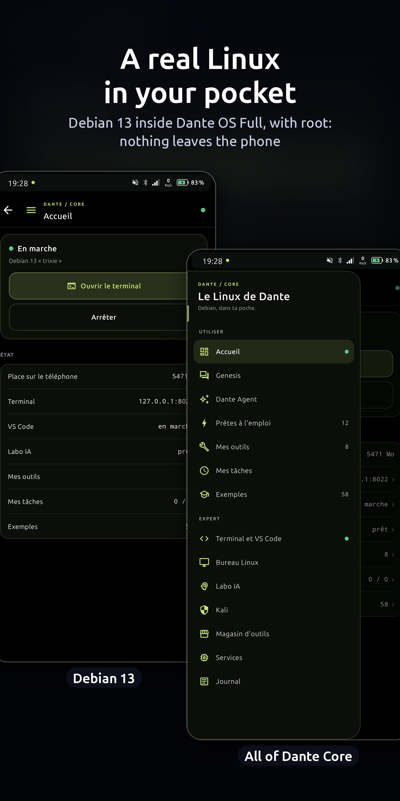 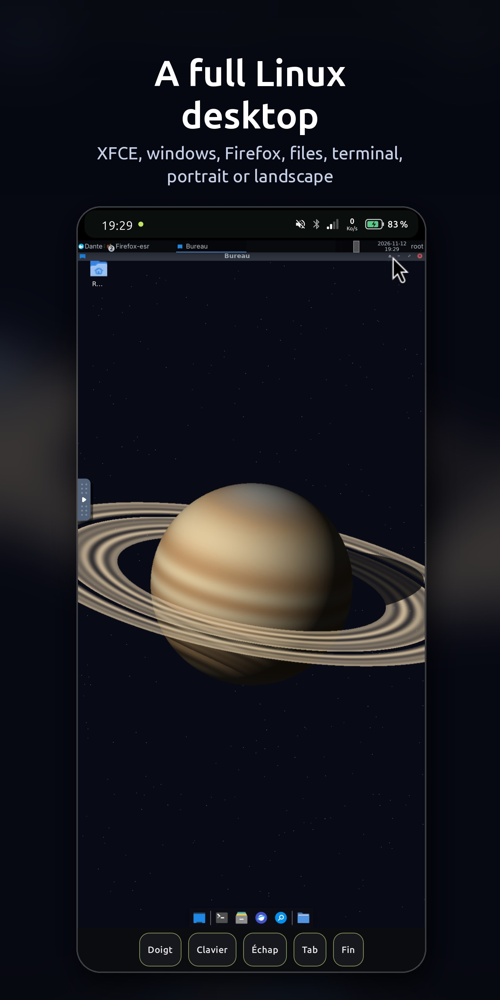 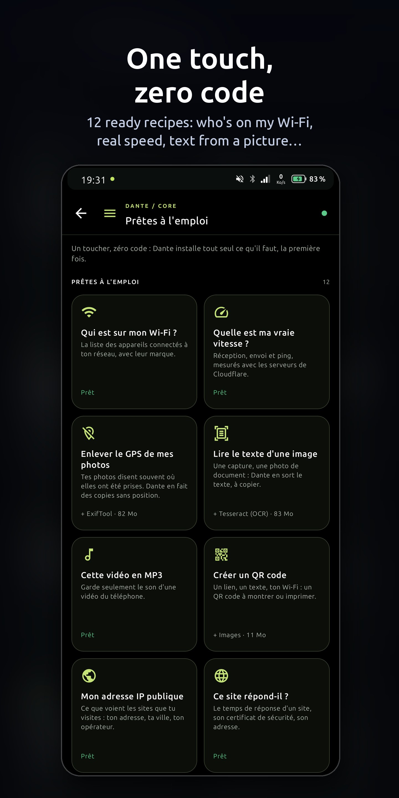

  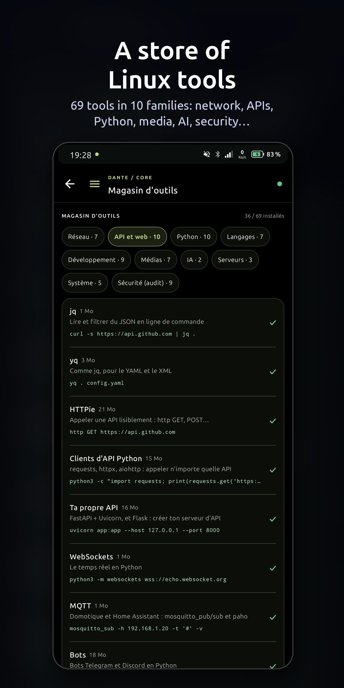 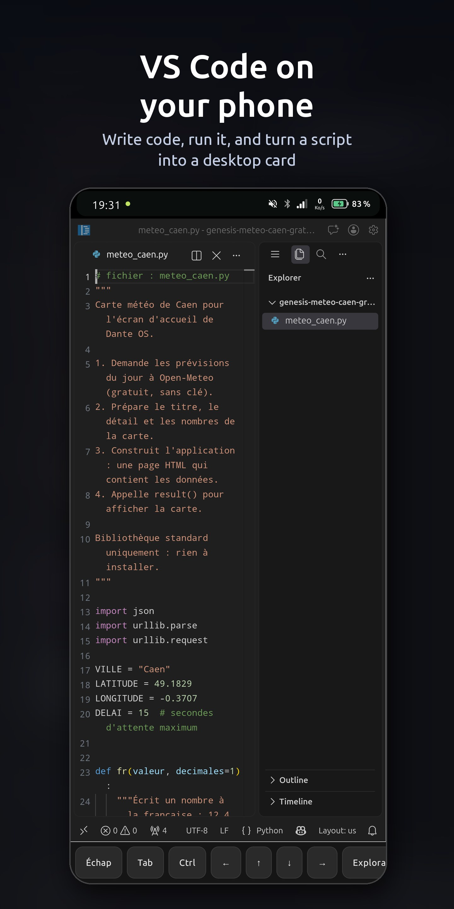 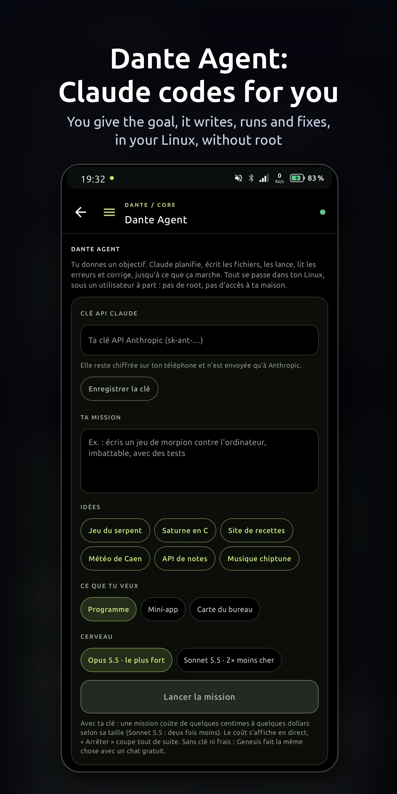

  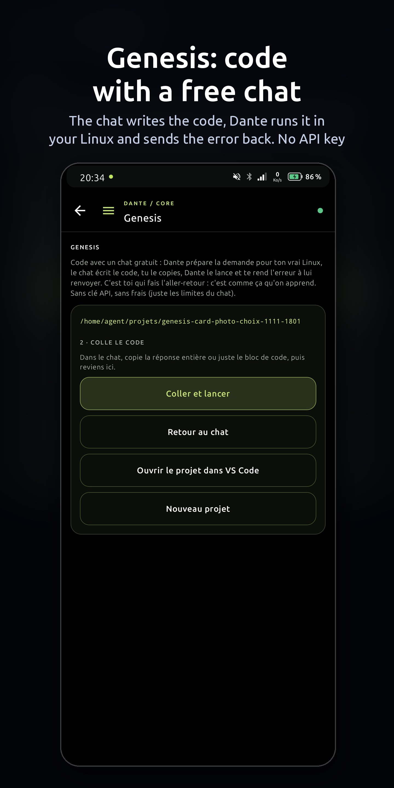 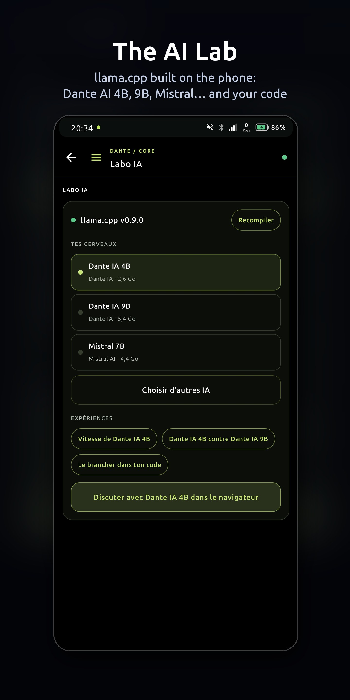 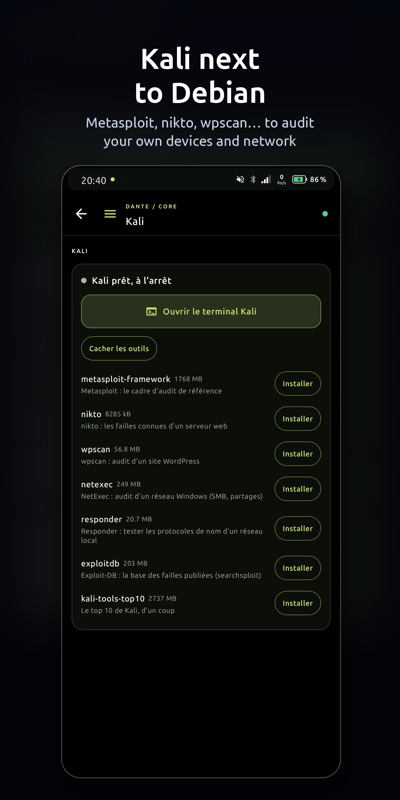

### Free, and Dante Pro

The launcher is free, for good: desktop, dock and its effects, widgets, folders, icons. Every module opens and can be explored.
**Dante Pro** (€5.99, once) unlocks the advanced use: Dante Core, Dante AI, Dante Engine, Dante FX, unlimited sources, SMB/FTP/SFTP servers…

In Dante OS Full: **Dante Pro ▸ Pay with PayPal** (write your email address in the message), you receive your key by email, you paste it in Dante. It needs the Internet once to activate; after that it works for good, even offline, on 3 phones with Dante OS Full.

### Install

1. Download **Dante-OS-5.0.0-Full.apk** from [Releases](../../releases).
2. Have the Play Store version? Uninstall it first (both can't live side by side). Keep your settings before: Desktop ▸ Customize ▸ Backup ▸ Export.
3. Open the APK and allow installs from this source.
4. For Dante Core and the root modules: a rooted phone (Magisk or KernelSU). Without root, everything else works.

Android 10 or newer, 64-bit ARM phone. Tested on OnePlus 13 (Android 16), Pixel and Fold (Android 16 and 17 emulators).

**Check the APK is genuine**: SHA-256 of the signing certificate
`78:FE:D6:BF:09:A3:EF:4D:CD:B7:C2:5F:F8:8E:E5:DA:EF:36:85:71:FA:AE:72:88:BE:C4:4C:4E:6C:1B:82:D7`
(a copy re-signed by someone else refuses Dante Pro keys).

### Fair use

Dante Core's security tools (network scan, audit…) are only for **your** devices and **your** networks.

### Privacy

No tracker, no statistics, no ads. Everything is explained here: **[privacy policy](https://picqueanthony-arch.github.io/dante-os-confidentialite/full.html)**.

Dante OS source code is not public: this repository only holds the app, its screenshots and this page.
Dante OS was imagined and directed by Dante, and coded with Claude (Anthropic).
Contact: [danteantpi@proton.me](mailto:danteantpi@proton.me)
